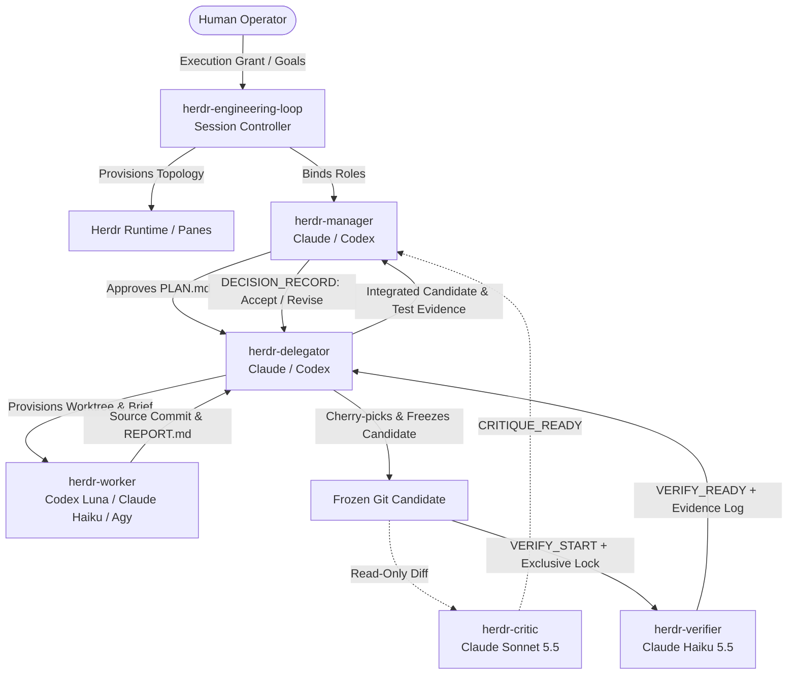
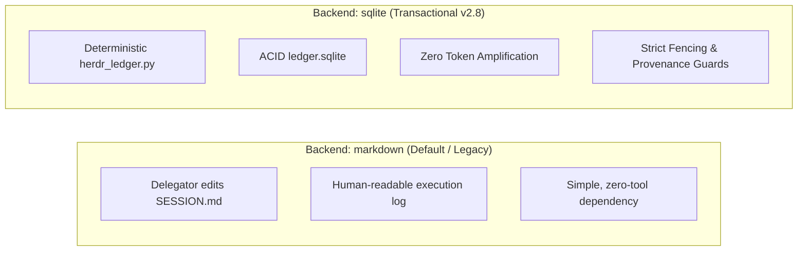

# Herdr Role Pack v2.8

A structured, multi-skill orchestration framework for autonomous coding agents (Claude Code, Codex, and Agy CLI) operating inside [Herdr](https://herdr.dev).

Rather than relying on a single all-powerful prompt or a complex external daemon, Herdr Role Pack divides software engineering across **six bounded, specialized agent roles**. State is coordinated transparently through Git and either human-readable Markdown or an ACID transactional SQLite ledger.

---

## Table of Contents

1. [Architectural Overview](#architectural-overview)
2. [The Six Specialized Roles](#the-six-specialized-roles)
3. [Dual State Engines: Markdown vs. SQLite](#dual-state-engines-markdown-vs-sqlite)
4. [Human-Facing Progress Presentation](#human-facing-progress-presentation)
5. [Installation](#installation)
   - [Zero-Dependency Node.js / npx (Cross-Platform)](#zero-dependency-nodejs--npx-cross-platform)
   - [Windows PowerShell](#windows-powershell)
   - [POSIX Shell (macOS / Linux)](#posix-shell-macos--linux)
6. [Quick Start & Run Workflow](#quick-start--run-workflow)
   - [Step 1: Configure the Roster](#step-1-configure-the-roster)
   - [Step 2: Bind Role Packets](#step-2-bind-role-packets)
   - [Step 3: Activate Live Agents](#step-3-activate-live-agents)
7. [CLI Reference: Transactional SQLite Ledger](#cli-reference-transactional-sqlite-ledger)
8. [Helper Tools Reference](#helper-tools-reference)
9. [Operational Invariants & Safety Rules](#operational-invariants--safety-rules)
   - [The Codex Subagent Invariant](#the-codex-subagent-invariant)
   - [Cross-Model Spawn Authority](#cross-model-spawn-authority)
   - [Worker Test-Execution Ban](#worker-test-execution-ban)
   - [Serial Heavy Verification Lock](#serial-heavy-verification-lock)
   - [Candidate Fencing & Git Provenance](#candidate-fencing--git-provenance)
   - [Fail-Closed Cancellation & Recovery](#fail-closed-cancellation--recovery)
10. [Directory Structure](#directory-structure)
11. [Troubleshooting & Diagnostics](#troubleshooting--diagnostics)

---

## Architectural Overview

Herdr Role Pack isolates context, capabilities, and authority to prevent context pollution, runaway edits, and hallucinated permissions.



### Core Design Principles
- **No Monolithic Prompts:** Agents receive strictly bounded instructions tailored exclusively to their current assignment.
- **Strict Separation of Concerns:** Implementation workers never run tests. Verifiers never edit code. Critics never test or integrate.
- **Zero Required External Runtimes:** The core role pack requires no Relays, background daemons, cloud services, or network databases.
- **Low-RAM Friendly:** Designed to operate comfortably on 8 GB-class laptops by enforcing single-worker defaults and a strictly serial heavy-test lock.

---

## The Six Specialized Roles

| Role & Skill | Recommended Engine | Primary Responsibility | Strict Boundaries | Key Deliverables |
| :--- | :--- | :--- | :--- | :--- |
| **`herdr-engineering-loop`**<br/>*(Session Controller)* | Human or Session Bootstrap | Inspects/reuses Herdr layout, binds agents, tracks topology, coordinates crash recovery. | Does not implement features, manage tasks, or run code tests. | `ROSTER.md`, `ACTIVATE.md`, role packets |
| **`herdr-manager`**<br/>*(Architectural Lead)* | Claude Sonnet / Opus or Codex | Owns approved plan, defines slice titles/outcomes, resolves ambiguities, renders final acceptance. | Does not dispatch workers, write code, or execute checks. | `PLAN.md`, architectural decisions, acceptance records |
| **`herdr-delegator`**<br/>*(Dispatcher & Integrator)* | Claude Sonnet or Codex | Provisions Git worktrees & Herdr panes, briefs workers, reviews code, integrates commits, manages test locks. | Does not generate architectural requirements or write production code. | `tasks/Txx.md`, integration branch, candidate hashes |
| **`herdr-worker`**<br/>*(Task Implementer)* | Codex GPT-6 Luna (`xhigh`), Claude Haiku 5.5, or Agy CLI | Implements exactly one task in an isolated Git worktree; writes source code and task report. | **STRICTLY FORBIDDEN** from running tests, builds, linters, typechecks, or package installations. | `reports/Txx.md`, source commit SHA |
| **`herdr-verifier`**<br/>*(Independent Tester)* | Claude Haiku 5.5 (preferred) or dedicated test agent | Executes approved test suites against the integration SHA under an exclusive global verification lock. | **STRICTLY FORBIDDEN** from editing application or test source code. | `verifications/Txx.md`, verification log, exit codes |
| **`herdr-critic`**<br/>*(Read-Only Reviewer)* | Claude Sonnet 5.5 in dedicated pane | Performs independent static reviews of plans, task briefs, and candidate Git diffs against architectural goals. | Read-only. Never tests, runs code, edits files, or dispatches workers. | `critiques/review-xx.md` |

> [!NOTE]
> All six skills are installed globally or locally per agent CLI. **Skill availability does not imply role assignment.** Agents operate purely according to the explicit role packet and activation prompt generated for the specific run.

---

## Dual State Engines: Markdown vs. SQLite

Herdr Role Pack v2.8 supports two interchangeable, mutually exclusive state backends configured via `roles.json`:



### Comparison Matrix

| Feature | Legacy Markdown (`SESSION.md`) | Transactional SQLite (`ledger.sqlite`) |
| :--- | :--- | :--- |
| **Primary Owner** | `herdr-delegator` | `scripts/herdr_ledger.py` (Controller/CLI) |
| **Context Window Overhead** | Increases linearly with run history (can exceed 130 KB / ~35k tokens) | **Zero context bloat**; state queries are targeted, bounded, and structured |
| **Concurrency & Atomic Fencing** | Advisory Markdown section headers | Strict ACID transactions, attempt fence counters, claim tracking |
| **Integration Provenance** | Manual hash comparisons in report text | Automated Git `patch-id` candidate matching |
| **Verification Gate** | Advisory Delegator lock text | Mandatory serial run lock, output capture, exit code recording |
| **Crash Recovery** | Manual prompt inspection and ledger editing | Deterministic `recover` subcommand cross-referencing Herdr CLI |
| **Opt-in Status** | Active default for existing and standard runs | Opt-in via `"state_backend": "sqlite"` in run configuration |

---

## Human-Facing Progress Presentation

Machine keys such as `T01`, `T01-A2`, Herdr pane IDs (`w35:p1`), and Git commit hashes are vital for durable handoffs, but they clutter human status updates. 

Herdr Role Pack decouples machine-facing coordination from human-facing reporting. The Manager assigns an evidence-grounded title and outcome to each slice, which is reflected in status output:

```
[PROGRESS] Slices: 1/1 accepted (100%) | Verification: PASS
  * Improve sign-in recovery messages: ACCEPTED
    - Outcome: Clear recovery instructions displayed on session expiry
    - Verification: Candidate 3abade0c verified cleanly (exit 0)
```

To view an on-demand, evidence-grounded human summary:

```powershell
# For Markdown-backed runs:
py -3 .\tools\progress_view.py --session "C:\path\to\repo\.herdr-loop\<run-id>\SESSION.md"

# For SQLite-backed runs:
py -3 .\tools\progress_view.py --db "C:\path\to\repo\.herdr-loop\<run-id>\ledger.sqlite"
```

To inspect raw internal task IDs, attempt counters, and Git SHAs for debugging, pass `--include-internal-ids`.

---

## Installation

The role pack installs skills into standard agent configuration directories:
- **Claude Code:** `%USERPROFILE%\.claude\skills\` (Windows) or `~/.claude/skills/` (macOS/Linux)
- **Codex:** `%USERPROFILE%\.agents\skills\` (Windows) or `~/.agents/skills/` (macOS/Linux)
- **Agy CLI:** `%USERPROFILE%\.gemini\antigravity-cli\skills\` (Windows) or `~/.gemini/antigravity-cli/skills/` (macOS/Linux)

### Zero-Dependency Node.js / npx (Cross-Platform)

Run directly using Node.js without compiling or installing external packages:

```bash
# Preview changes without modifying files:
npx . --dry-run

# Install all six skills for Claude Code, Codex, and Agy CLI:
npx .

# Overwrite / update previously installed skills:
npx . --force

# Install selectively for specific agents or roles:
npx . --agents claude,codex --roles manager,delegator

# Uninstall pack-managed skills:
npx . --uninstall
```

### Windows PowerShell

Native script execution without requiring Node.js or Python:

```powershell
# Review execution and install:
powershell -NoProfile -ExecutionPolicy Bypass -File .\install.ps1

# Options:
.\install.ps1 -DryRun                     # Dry run preview
.\install.ps1 -Force                      # Refresh installed copies
.\install.ps1 -WithHerdr                  # Also install release-matched CLI skill from local 'herdr' binary
.\install.ps1 -Agents Claude,Codex        # Target specific agents
.\install.ps1 -Uninstall                  # Safely remove only installer-managed skills
```

### POSIX Shell (macOS / Linux)

```sh
sh ./install.sh
sh ./install.sh --dry-run
sh ./install.sh --force --with-herdr
sh ./install.sh --agents claude,codex --roles manager,delegator
sh ./install.sh --uninstall
```

---

## Quick Start & Run Workflow

### Step 1: Configure the Roster

Create a run configuration file (e.g. `roles.json`) based on the templates in `examples/`:

```json
{
  "run_id": "auth-flow-v1",
  "base_ref": "main",
  "state_backend": "sqlite",
  "max_active_workers": 1,
  "parallel_workers_authorized": false,
  "agents": {
    "manager": { "name": "arch_lead", "kind": "claude" },
    "delegator": { "name": "lead_dev", "kind": "codex" },
    "worker": {
      "name": "worker_t01",
      "kind": "codex",
      "task_id": "T01",
      "attempt_id": "T01-A1",
      "task_title": "Fix token expiration edge case",
      "task_outcome": "Expired tokens redirect cleanly to /login with 401 code",
      "model": "gpt-6-luna",
      "effort": "xhigh"
    },
    "verifier": { "name": "test_agent", "kind": "claude", "model": "claude-haiku-5-5" },
    "critic": { "name": "arch_critic", "kind": "claude", "model": "claude-sonnet-5-5" }
  }
}
```

### Step 2: Bind Role Packets

Generate targeted role packets and activation instructions:

```powershell
py -3 .\tools\role_bind.py --config .\roles.json --repo "C:\path\to\target-repo"
```

This provisions `<target-repo>/.herdr-loop/<run-id>/`:
- `ROSTER.md` — Named agent assignment and model topology.
- `ACTIVATE.md` — Copy-paste startup prompts for human operators.
- `ACTIVATION.json` — Machine-readable startup instructions.
- `role-packets/<agent>.md` — Role constraints, boundaries, and signal addresses.
- `ledger.sqlite` *(if `state_backend: "sqlite"`)* — Initialized transactional ledger database.
- `SESSION.md` *(if `state_backend: "markdown"`)* — Delegator markdown ledger.

### Step 3: Activate Live Agents

Start the panes and agents in Herdr, then dispatch activation packets:

```powershell
# Dispatches activation prompts to registered Herdr panes (requires HERDR_ENV=1):
py -3 .\tools\activate_roles.py --run-dir "C:\path\to\target-repo\.herdr-loop\auth-flow-v1"
```

---

## CLI Reference: Transactional SQLite Ledger

When using the SQLite backend, `skills/herdr-engineering-loop/scripts/herdr_ledger.py` enforces deterministic state transitions:

### Initialization & Planning
```bash
# Initialize a new run ledger:
python scripts/herdr_ledger.py init --db <path-to-db> --run-id <run-id> --base-ref <base-commit>

# Synchronize an approved plan revision:
python scripts/herdr_ledger.py plan-sync --db <path-to-db> --plan <path-to-PLAN.md> --revision 1
```

### Worker Attempt Lifecycle
```bash
# 1. Reserve a task slice for a worker attempt:
python scripts/herdr_ledger.py task-reserve --db <path-to-db> --task T01 --attempt T01-A1 \
  --worker worker_t01 --worktree <path-to-worktree> --title "Slice title" --outcome "Expected outcome"

# 2. Attach Herdr runtime process identity:
python scripts/herdr_ledger.py attempt-attach --db <path-to-db> --task T01 --attempt T01-A1 \
  --workspace w35 --pane w35:p1 --agent worker_t01

# 3. Record observed worker ROLE_READY signal:
python scripts/herdr_ledger.py attempt-ready --db <path-to-db> --task T01 --attempt T01-A1 \
  --receipt <path-to-READY.md> --operator agy_operator

# 4. Authorize implementation start:
python scripts/herdr_ledger.py attempt-start --db <path-to-db> --task T01 --attempt T01-A1 \
  --plan-revision 1 --operator agy_operator

# 5. Record worker completion and source commit:
python scripts/herdr_ledger.py attempt-report --db <path-to-db> --task T01 --attempt T01-A1 \
  --report <path-to-REPORT.md> --commit <worker-sha>
```

### Integration, Critique & Verification
```bash
# 6. Freeze integrated Git candidate (validates patch-id matching):
python scripts/herdr_ledger.py candidate-freeze --db <path-to-db> --candidate C01 --task T01 \
  --attempt T01-A1 --source-commit <worker-sha> --integration-commit <cherry-pick-sha>

# 7. Record read-only Critic findings (optional gate):
python scripts/herdr_ledger.py critique-record --db <path-to-db> --review R01 --candidate C01 \
  --critic critic_agent --report <path-to-CRITIQUE.md> --verdict ACCEPT

# 8. Acquire serial test lock and initiate verification:
python scripts/herdr_ledger.py verify-start --db <path-to-db> --verification V01 --candidate C01 \
  --verifier test_agent --command "pytest -q"

# 9. Execute verified command, log evidence, and release lock:
python scripts/herdr_ledger.py verify-exec --db <path-to-db> --verification V01 \
  --cwd <path-to-integration-repo> --output <path-to-V01.log>
```

### Acceptance & Recovery
```bash
# 10. Record Manager architectural decision:
python scripts/herdr_ledger.py decision-record --db <path-to-db> --decision D01 --candidate C01 \
  --manager arch_lead --outcome ACCEPT --rationale "All checks passed cleanly"

# 11. Mark task slice accepted:
python scripts/herdr_ledger.py task-accept --db <path-to-db> --task T01 --candidate C01

# Diagnose state and reconcile interrupted attempts:
python scripts/herdr_ledger.py recover --db <path-to-db>
```

---

## Helper Tools Reference

- **`tools/role_bind.py`**:
  Parses configuration files, enforces backend exclusivity, builds agent role packets, and creates activation maps.
  ```powershell
  py -3 .\tools\role_bind.py --config .\roles.json --repo <repo-path> [--force] [--dry-run]
  ```

- **`tools/activate_roles.py`**:
  Connects to the local Herdr CLI (`HERDR_ENV=1`) and sends prompt envelopes to registered panes.
  ```powershell
  py -3 .\tools\activate_roles.py --run-dir <run-dir> [--roles manager,delegator]
  ```

- **`tools/progress_view.py`**:
  Generates user-facing progress dashboards decoupled from machine IDs.
  ```powershell
  py -3 .\tools\progress_view.py [--session <path-to-SESSION.md> | --db <path-to-ledger.sqlite>]
  ```

- **`tools/access_probe.py`**:
  Diagnoses pane access, Herdr CLI socket availability, and filesystem write permissions without elevating privileges.
  ```powershell
  py -3 .\tools\access_probe.py --workspace <worktree-path> --agent <agent-name> --probe-write
  ```

---

## Operational Invariants & Safety Rules

### The Codex Subagent Invariant
> [!CAUTION]
> **Never use Codex native `spawn_agent`, internal subagents, agent teams, or background child threads.**
> 
> Internal Codex subagents have no registered Herdr pane, no worktree isolation, and violate execution auditing. All agents must be explicitly provisioned in Herdr panes. If Herdr is unavailable, halt with `BLOCKED: HERDR_WORKER_UNAVAILABLE`.

### Cross-Model Spawn Authority
Due to environment restrictions, a **Codex Delegator cannot launch a model-overridden Codex CLI worker** (`-m gpt-6-luna -c model_reasoning_effort='"xhigh"'`).

| Delegator Engine | Manager Engine | Authorized Spawner of Overridden Codex Worker |
| :--- | :--- | :--- |
| **Claude** | Any | **Claude Delegator** launches directly. |
| **Codex** | **Claude** | **Claude Manager** launches via one-time `SPAWN-REQUEST.md` handshake. |
| **Codex** | **Codex** | **Human Operator** launches manually via Herdr CLI. |

### Worker Test-Execution Ban
Workers are strictly restricted to writing application code and generating `REPORT.md`. **Workers must never execute test suites, linters, typecheckers, or build scripts.** This prevents context pollution from repetitive test-failure cycles and preserves memory on low-resource machines.

### Serial Heavy Verification Lock
Local verification commands are gated by a run-wide lock (`active_verification_lock`). **At most one expensive local test or build process may run across the entire machine at any given time**, regardless of how many workers are active.

### Candidate Fencing & Git Provenance
Before tests run, the Delegator freezes the integration Git checkout. 
- The SQLite ledger verifies that the integrated cherry-pick produces the exact same `git patch-id` as the worker's original branch commit.
- If code changes occur during a test run, the check is immediately marked stale and must be re-run.

### Fail-Closed Cancellation & Recovery
- Issuing `CANCEL_RUN` stops future dispatches immediately.
- Running agent processes are observed via Herdr CLI to confirm clean termination before locks or claims are released.
- Panes owned by human operators and dirty Git worktrees are never automatically deleted.

---

## Directory Structure

```text
herdr-role-pack/
├── package.json                   # Zero-dependency npm / npx manifest
├── bin/
│   └── install.js                 # Cross-platform Node.js installer
├── install.ps1                    # Native Windows PowerShell installer
├── install.sh                     # POSIX shell installer (Linux / macOS)
├── manifest.json                  # Skill definitions and metadata
├── examples/
│   ├── roles.example.json         # Standard multi-role configuration
│   ├── roles.claude-haiku.json    # Haiku worker + Sonnet critic configuration
│   ├── roles.codex-override.json  # Codex Luna (xhigh) spawner configuration
│   └── roles.haiku-verifier.json  # Dedicated Claude Haiku tester configuration
├── skills/
│   ├── herdr-engineering-loop/    # Session controller skill & SQLite ledger
│   │   ├── SKILL.md
│   │   ├── scripts/
│   │   │   └── herdr_ledger.py    # ACID SQLite state engine
│   │   └── references/            # Contract specs (signals, triage, pilot)
│   ├── herdr-manager/             # Architectural lead skill
│   ├── herdr-delegator/           # Dispatcher & integrator skill
│   ├── herdr-worker/              # Task implementer skill
│   ├── herdr-verifier/            # Dedicated sequential tester skill
│   └── herdr-critic/              # Independent read-only reviewer skill
├── tools/
│   ├── role_bind.py               # Packet generator & backend binder
│   ├── activate_roles.py          # Herdr pane prompt dispatcher
│   ├── progress_view.py           # Human-facing status presenter
│   └── access_probe.py            # Diagnostic & permission tester
└── tests/                         # Comprehensive automated test suite
```

---

## Troubleshooting & Diagnostics

### Permission & Access Denied Errors
If an agent reports permission errors accessing Herdr or the workspace:
1. Run `tools/access_probe.py --workspace <path> --agent <name> --probe-write`.
2. Verify that `HERDR_ENV=1` is active in the environment.
3. Check if Docker Desktop named pipe security or Windows WSL network isolation is blocking local IPC.
4. **Do not** elevate privileges to Administrator or disable sandboxes.

### Broken Signals or Stalled Panes
If an agent fails to respond to a Herdr prompt:
1. Check process status: `herdr pane list` and `herdr agent list`.
2. Inspect the worker pane directly to check for model quotas or command prompts awaiting confirmation.
3. If a pane was closed externally, run `python scripts/herdr_ledger.py recover --db <path-to-db>` to release held locks and mark interrupted attempts as `BLOCKED`.
