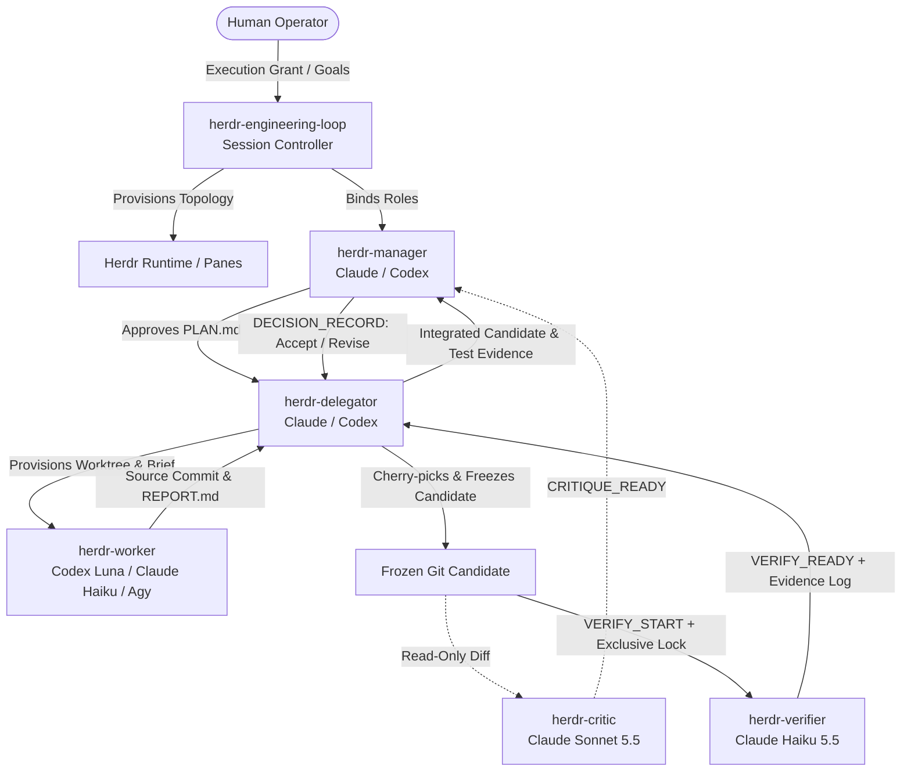

# Operations & Architecture Guide for Herdr Role Pack

This document details the operational architecture, state models, candidate Git provenance, and verification locks for the **Herdr Role Pack**.

---

## 1. System Architecture & Lifecycle



### Core Invariants:
1. **Separation of Concerns:** Workers write code but never execute tests. Verifiers execute tests but never edit code. Critics perform read-only reviews. Managers make architectural and acceptance decisions.
2. **Real Herdr Panes:** Workers must be spawned inside registered Herdr panes. Native Codex subagents (`spawn_agent`, agent teams) are strictly forbidden.
3. **Candidate Fencing:** Before running tests, the integration checkout is frozen. Any subsequent modification invalidates ongoing verification.
4. **Serial Heavy Verification Lock:** At most **one** memory-heavy local test or build process may run at any time within the run database scope (enforced via SQLite `heavy-local-verification` claim in pilot runs; advisory in standard `SESSION.md` runs). Across independent run databases, operators must coordinate workloads manually.

---

## 2. State Engines: Standard Markdown vs. Offline SQLite Pilot

### Standard Production Engine: Delegator-Owned `SESSION.md`
- **Status:** **Active Default & Supported.**
- **File:** `<repo>/.herdr-loop/<run-id>/SESSION.md`.
- **Properties:** Transparent, plain Markdown, human-editable, zero-dependency.
- **Workflow:** The Delegator updates the task frontier, commit mapping, and verification locks directly in `SESSION.md`.

### Experimental Pilot Engine: ACID SQLite Ledger (`ledger.sqlite`)
- **Status:** **Offline Opt-in Pilot Only.**
- **File:** `<repo>/.herdr-loop/<run-id>/ledger.sqlite`.
- **Tool:** `skills/herdr-engineering-loop/scripts/herdr_ledger.py`.
- **Purpose:** Evaluates eliminating context window amplification (e.g. 130KB+ `SESSION.md` logs) through deterministic transactional CLI state transitions.
- **Mutual Exclusion:** Routine role binding (`tools/role_bind.py`) fails closed if configured with `state_backend: "sqlite"` to prevent half-initialized runs. The SQLite ledger CLI is invoked explicitly for isolated offline pilot testing.

---

## 3. SQLite Ledger CLI Reference (Offline Pilot)

When running the offline SQLite ledger CLI (`skills/herdr-engineering-loop/scripts/herdr_ledger.py`), state transitions require `--run-dir <path>`:

### Initialization & Planning
```bash
# Initialize a new run ledger:
python skills/herdr-engineering-loop/scripts/herdr_ledger.py --run-dir <run-dir> init \
  --run-id R01 --repo <repo-path> --plan PLAN.md --grant-ref <base-commit> --max-workers 1

# Add a planned task:
python skills/herdr-engineering-loop/scripts/herdr_ledger.py --run-dir <run-dir> task-add \
  --task T01 --title "Fix token redirect" --outcome "Redirects 401" --brief briefs/T01.md --request-id req-add-1
```

### Worker Attempt Lifecycle
```bash
# 1. Reserve a task attempt:
python skills/herdr-engineering-loop/scripts/herdr_ledger.py --run-dir <run-dir> attempt-reserve \
  --task T01 --attempt T01-A1 --checkout <worktree-path> --agent worker_a1 --provider codex \
  --expected-model gpt-6-luna --expected-effort xhigh --request-id req-res-1

# 2. Attach Herdr process:
python skills/herdr-engineering-loop/scripts/herdr_ledger.py --run-dir <run-dir> attempt-attach \
  --attempt T01-A1 --pane w35:p1 --agent worker_a1 --request-id req-att-1

# 3. Record observed ROLE_READY:
python skills/herdr-engineering-loop/scripts/herdr_ledger.py --run-dir <run-dir> attempt-ready \
  --attempt T01-A1 --operator delegator --operator-pane w32:p2 --event-id ready1 \
  --evidence READY.md --receipt receipt.txt --request-id req-rdy-1

# 4. Authorize TASK_START:
python skills/herdr-engineering-loop/scripts/herdr_ledger.py --run-dir <run-dir> attempt-start \
  --attempt T01-A1 --operator delegator --operator-pane w32:p2 --sender-pane w32:p2 \
  --event-id start1 --evidence TASK-ACK.md --receipt start-receipt.txt --request-id req-str-1

# 5. Record REPORT_READY:
python skills/herdr-engineering-loop/scripts/herdr_ledger.py --run-dir <run-dir> attempt-report \
  --attempt T01-A1 --evidence REPORT.md --source-sha <worker-sha> \
  --event-id report1 --recipient delegator --receipt rpt-rcpt.txt --request-id req-rpt-1
```

### Verification & Reconciliation
```bash
# Acquire serial lock:
python skills/herdr-engineering-loop/scripts/herdr_ledger.py --run-dir <run-dir> verify-start \
  --verification V01 --candidate C01 --verifier test_agent --request-id req-vst-1

# Execute verified command:
python skills/herdr-engineering-loop/scripts/herdr_ledger.py --run-dir <run-dir> verify-exec \
  --verification V01 --request-id req-vex-1 -- pytest -q

# Reconcile an interrupted verification (checks process quiescence):
python skills/herdr-engineering-loop/scripts/herdr_ledger.py --run-dir <run-dir> verify-reconcile \
  --verification V01 --reason "process observed dead" --request-id req-rec-1
```
